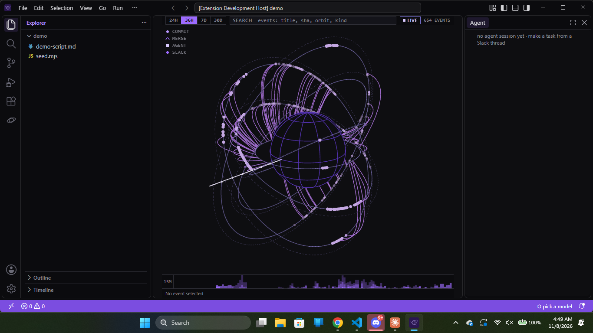

# Nexus

**Code, team chat, and coding agents in one desktop app.**

Nexus is a fork of [Code - OSS](https://github.com/microsoft/vscode) (the open-source code behind VS Code) with one built-in extension, `extensions/nexus`, that puts your team's real Slack workspace, gated coding agents, and the repository's history on one screen. A bug reported in a Slack thread becomes a task, an agent works it on its own branch while the thread and the session view update live, a teammate approves the commit from their phone, and the result orbits the globe on the home screen.

Built in 36 hours for a hackathon by Adrian ([@Bomoga](https://github.com/Bomoga)), Brandon ([@brandondelgadoo](https://github.com/brandondelgadoo)), and Elkin ([@aerr0c](https://github.com/aerr0c)).



## What it does

| | |
|---|---|
| **Slack, in the editor** | The Slack view lists the channels you are in, shows history and threads with names and avatars, and posts and replies **as you** (your own user token). New messages arrive live over Socket Mode. What the agent says is always posted by the Nexus bot, never as a person. |
| **Thread to task** | **MAKE TASK** on a thread builds a brief that quotes the thread and resolves its code references. Edit the brief, pick a model, start the agent. The agent keeps one progress message in the thread and edits it in place. |
| **Gated agents** | Agents run in a child process and reach files, commands, git, and Slack only through the extension host's gate. Each session gets its own git worktree and branch (`nexus/agent-<id>`). Running a command that is not on the allowlist, committing, and writing outside the worktree each require a human's approval. Agents never push or merge. |
| **Approval from anywhere** | An approval request shows up as a notification, in the Approvals view, as a Slack message with buttons, and (through Auth0 CIBA) as a push to the approver's phone. The first human answer wins; every surface shows who decided. |
| **Model picker** | Connect Anthropic, Google Gemini, or Swarms with an API key. The status bar picker lists the models each key actually returns, with the provider's data-use label. The Optimize with Prune toggle routes text-only calls through Prune and records a signed receipt per call. |
| **Live code references** | Select lines, right-click **Share to Slack**. The message carries a `nexus://` link pinned to the exact commit and a snippet for people without Nexus. Clicking the link opens those lines at that commit. |
| **The globe** | The home screen. One orbit per branch family, angle is time, merges arc between orbits, agent sessions and Slack tasks ride each orbit's activity ring. Search any event in the store and the globe tracks it. Click an event to open its commit, session, or thread. A flat timeline is the fallback. |
| **Shared across the team** | Events, sessions, approvals, swarm reviews, and receipts sync through a Tiger Cloud (Postgres + TimescaleDB) service, so everyone's globe shows everyone's agents live. A local append-only copy keeps each machine working offline. |
| **Swarm review** | Before a human approves a commit, a CouncilAsAJudge swarm reviews the diff and its verdict and per-judge notes appear on the approval card, labeled model-written. It advises; it never decides. A HierarchicalSwarm can break a large task into subtasks that the human accepts before anything runs. |

The full product definition, contracts, and rails are in [CLAUDE.md](CLAUDE.md); the task-by-task plan is [docs/PLAN.md](docs/PLAN.md); the demo script is [demo/demo-script.md](demo/demo-script.md).

## Repository layout

Nexus touches VS Code's core as little as possible. Core changes are branding (`product.json`, `resources/`), startup defaults, and the tab-less home editor. Everything else is the extension.

```
extensions/nexus/
  contributes/        per-lane package.json fragments, merged by scripts/merge-contributes.mjs
  src/contracts/      Zod schemas, inferred types, protocol map, fixtures (frozen at cp-0)
  src/models/         provider interface: Anthropic, Gemini, Swarms, Prune adapter
  src/agent/          process host, brief builder, prompt framing
  src/agent-process/  the agent runtime (tool loop) that runs in a child process
  src/features/       accounts, sessions, approvals, auth, home, git views, receipts
  src/services/       slack, git, events store, code refs, gate
  src/bridge/         typed webview <-> extension message router
  webviews/           React webviews: globe, timeline, chat, git, session, approvals, task, plan, shared kit
  sql/                Tiger Cloud schema (hypertables, continuous aggregates, NOTIFY triggers)
  auth-service/       Cloudflare Worker that runs Auth0 CIBA requests
  themes/             Nexus Dark
demo/                 seed.mjs builds the demo repo; demo-script.md is the demo
docs/                 PLAN.md, lane playbooks, the design report, the globe prototype
progress/             one progress file per lane
```

## Running it

Prerequisites are the same as VS Code's: Node at the version in `.nvmrc` (24.22.1), Python, and on Windows the Visual Studio Build Tools with the C++ desktop workload. See the VS Code wiki's [How to Contribute](https://github.com/microsoft/vscode/wiki/How-to-Contribute) page.

Clone into a short path with no spaces, outside any cloud-synced folder. Then build the fork once and keep its watch running:

```bash
npm install
npm run watch
```

The first build takes several minutes; incremental rebuilds take under a minute. In a second terminal build the extension:

```bash
cd extensions/nexus
npm ci
npm run watch
```

Launch the fork. The extension is registered with the fork's build, so it loads as a built-in:

```bash
.\scripts\code.bat        # Windows
./scripts/code.sh         # macOS and Linux
```

Open a git repository. The globe fills the editor area, the Nexus activity bar container holds the Slack, Git, and Approvals views, and the Agent view sits in the secondary side bar. The status bar shows "pick a model" until a provider is connected.

To try it on the demo repo, run `node demo/seed.mjs --out <folder> --force --t0 <now, ISO>` (or the command **Nexus (dev): Re-seed demo repo**) and open `<folder>`.

## Connecting things

Everything is optional; Nexus runs offline on the local store with nothing connected.

| What | How |
|---|---|
| Model providers | **Nexus: Connect provider** stores an Anthropic, Google Gemini, or Swarms API key in VS Code's secret storage. The picker shows only models the key returns. |
| Slack | **Nexus: Connect Slack** takes the workspace's Nexus app tokens: an app-level token for Socket Mode, the bot token, and your own user token so posts appear as you. The bot must be in every channel you want live updates from. |
| Sign-in and phone approvals | `nexus.auth0.domain`, `nexus.auth0.clientId`, and `nexus.auth0.audience` point at an Auth0 tenant with a native (PKCE) application whose callback is `nexus://nexus.nexus/auth/callback`. `nexus.ciba.serviceUrl` points at a deployed [auth service](extensions/nexus/auth-service/README.md). |
| Shared store | Set `TIGER_URL` (or the secret `nexus.tiger.url`) to a Tiger Cloud connection string after applying the [schema](extensions/nexus/sql/README.md). Without it everything stays on the local copy. |
| Prune | Connect a Prune key like any provider, then flip **Optimize with Prune** in the picker. Off by default. |
| Command allowlist | `nexus.agent.allowedCommands` lists commands an agent may run without asking. It starts empty. |
| T+ times | `nexus.t0` is the start time the globe's T+ labels count from. |

Keys and tokens live in secret storage or environment variables. They never reach a webview, a log, the event store, a Slack message, a prompt, or a commit. The agent process receives a key per call and never writes it anywhere.

## Development

The fast loop never rebuilds the fork. Inside `extensions/nexus`:

```bash
npm test                  # vitest unit tests, no network, no real keys
npm run typecheck
npm run lint
npm run build
npm run contributes:check # the per-lane fragments still merge cleanly
npm run ci                # all of the above, what GitHub Actions runs on every PR
npm run test:int          # integration tests against real providers; keys from .env (see .env.example)
```

Unit tests mock the model layer and the gate. Only `*.int.test.ts` files reach the network, and each skips itself when its key is missing.

Branches: `main` always builds and launches. Each lane works on `lane-1`, `lane-2`, or `lane-3` and reaches `main` by pull request. Checkpoints are tags (`cp-0` onward). Upstream VS Code is pinned at `1.145.2` and never merged. The rest of the rules (commits, worktrees per worker task, the lead's merge procedure, safety rails) are in [CLAUDE.md](CLAUDE.md).

## Safety rails, in short

- Providers connect with API keys. There is no "Sign in with Claude" or any other consumer-account login.
- Agents propose, humans dispose. An agent works in its own worktree, asks before risky actions, and never pushes or merges.
- Slack text, repo contents, and command output are data, not instructions. They enter prompts only inside quoted, delimited blocks.
- Diffs shown anywhere come from `git`, never from the model's description. Model-written text is labeled as such.
- Swarm reviews and plans are text that a human reads. Swarms never touches files, and its built-in tools are never enabled.
- Webviews run under a strict CSP with no Node, no remote content, and no secrets. Every bridge message is schema-validated on both sides.

## License

Nexus is built on Code - OSS, which Microsoft releases under the MIT license. `LICENSE.txt` and `ThirdPartyNotices.txt` are upstream's and apply to the code Nexus builds on. Everything under `extensions/nexus`, `demo/`, `docs/`, and `progress/` is the Nexus team's work.
