# Design night report (2026-11-08, 02:25 to 06:00 ET)

For the reader who opens Nexus at 08:00 and demos it. Written by the Lane 1 lead session; playbook: `docs/playbooks/design-night.md`. Images are in `docs/design/screens/before/` and `docs/design/screens/after/` (1280×800 headless Chrome at `?fake=1`, plus 360-wide shots for side-bar views; narrow headless shots squeeze multi-column tables, the real browser does not).

## 1. Status line

_(filled at the end)_

## 2. Before / after

### Globe home (`webviews/globe`)

| before | after |
|---|---|
| 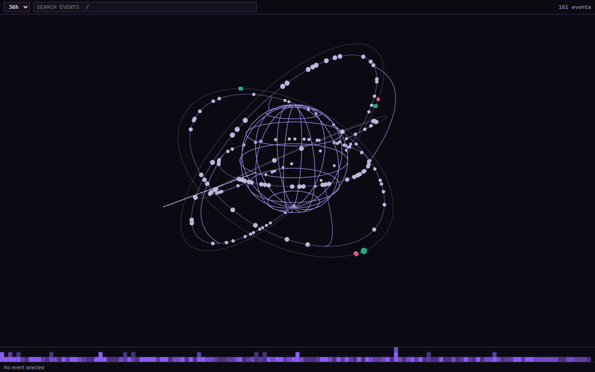 | 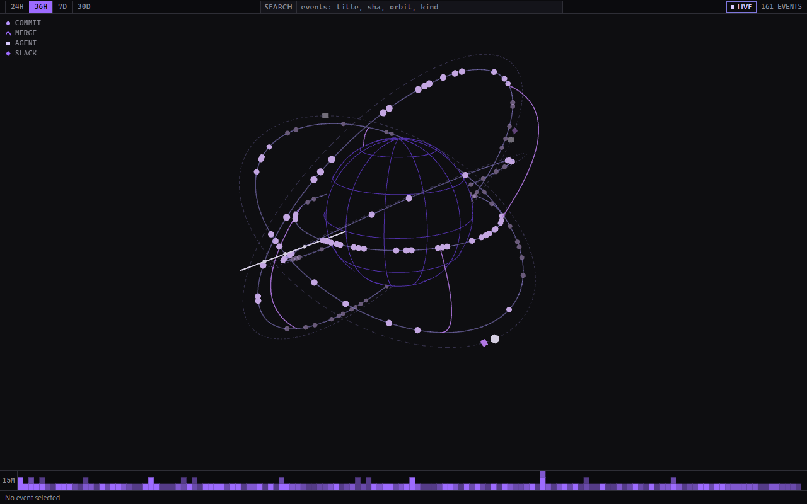 |

- One 22 px header row: segmented 24H · 36H · 7D · 30D (active segment filled purple with dark text), prefixed SEARCH input, LIVE badge or VIEWING T+hh:mm with BACK TO LIVE, N EVENTS in mono; a four-glyph legend overlay top-left; the activity strip has a 15M gutter; StoreStatusLine moved to the bottom.
- Scene in one purple ramp: planet wire in `--nx-accent-deep`, orbits 1.5 px in `--nx-accent-lo` (drei `Line`), dashed activity rings, a 2 px glow now line with a dot at each orbit crossing, commit spheres `accent-hi`, merge arcs 1.5 px (three `Line2`), agent cubes `accent-glow`, Slack diamonds `accent`; the green and pink markers are gone; far-side markers fade to 0.5; hover scales a marker 1.3× and previews it in the detail strip; selected events get a 1 px glow ring; canvas `dpr [1, 1.5]`, `powerPreference: low-power`; rotation stops under `prefers-reduced-motion`.
- Behaviour unchanged (search Enter/Escape, tracking, click → `ui.openTarget`, live inserts, window switch → `ui.setTimeWindow`); two test assertions moved from a `<select>` to the segmented control.

### Timeline fallback (`webviews/timeline`)

| before | after |
|---|---|
| 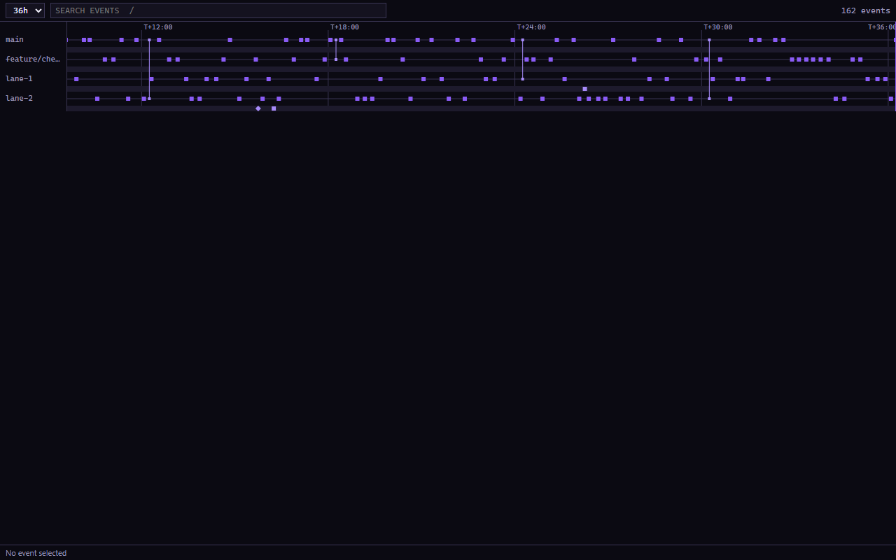 | 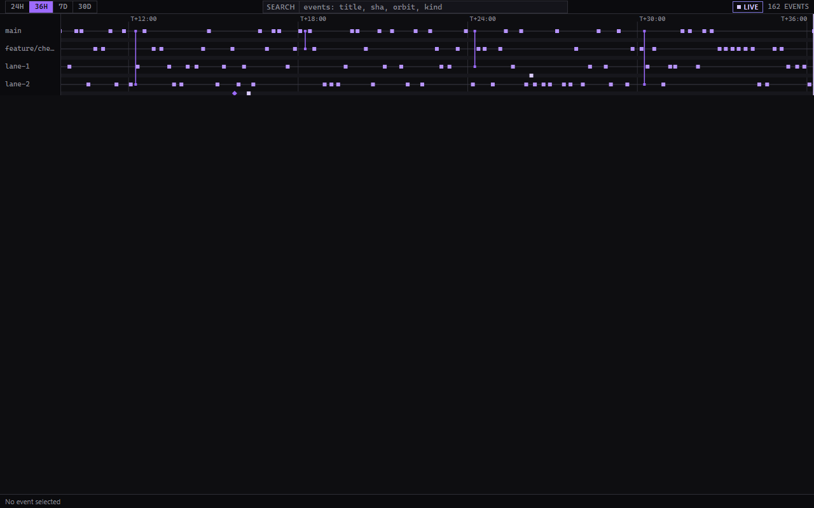 |

- Shares the globe's header row, search, detail strip and `globe.css`.
- Lanes 22 px, marks in the purple ramp, the last axis tick no longer clips.
- Still no activity strip (it never had one); it shows LIVE always.

### Git view (`webviews/git`, new)

| before | after |
|---|---|
| _(did not exist; `Nexus: Open commit` and `Merge agent branch` were quick picks only)_ | 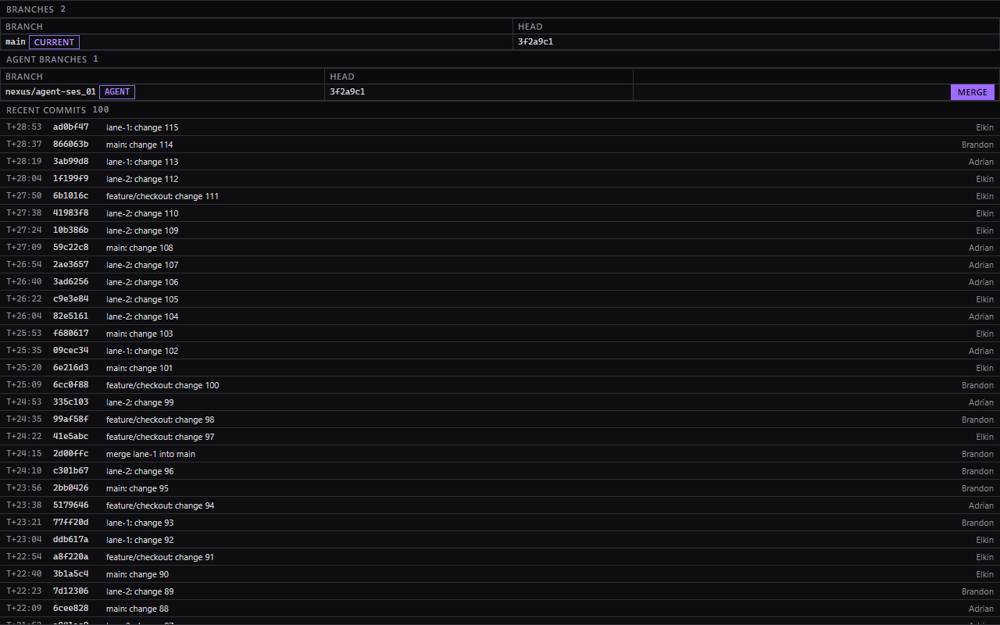 |

- Three touching regions in the primary side bar between Slack and Approvals: BRANCHES (name, CURRENT badge, short SHA), AGENT BRANCHES (AGENT chip, MERGE → CONFIRM MERGE / CANCEL inline, result line "merged as <sha>" or the clean-abort message in red), RECENT COMMITS (last 24 h, `T+ · sha · title · actor`, click or Enter → `ui.openTarget`).
- Served entirely by the bridge (`git.branches`, `git.mergeAgentBranch`, `events.query`); repo text rendered as text only.
- Narrow (360 px) shot: `screens/after/git-narrow.png`; headless Chrome squeezes the MERGE column there, the real browser does not.

### Agent view (`webviews/session`, hosted as `nexus.agent` in the secondary side bar)

| before | after |
|---|---|
| 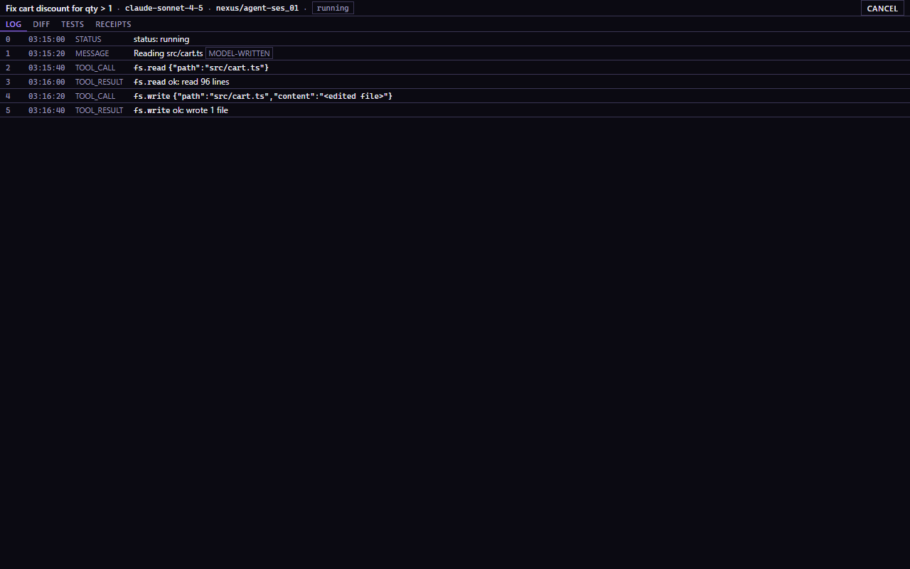 | 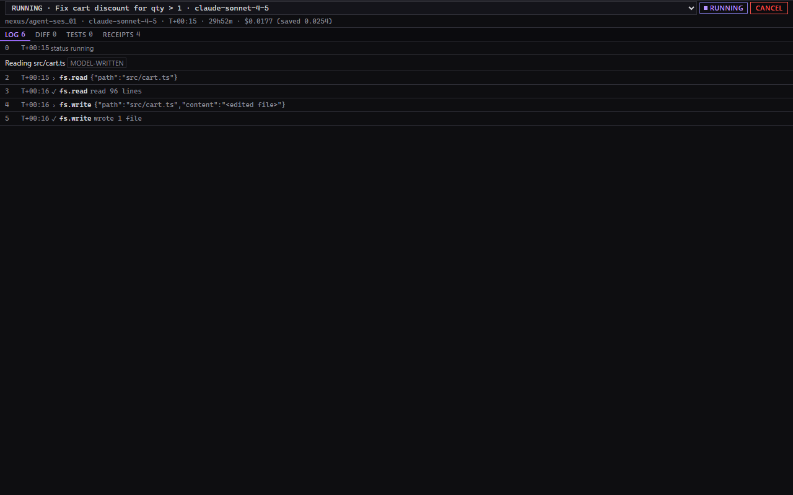 |

- Runs as a view with no session id: it calls `sessions.list`, shows the newest running/awaiting session first and offers a switcher (`STATUS · task title · modelId`); a host-supplied `<body data-session-id>` still wins; switching re-subscribes from seq 0, resets state and drops any late answer from the previous session (reviewer-found race, fixed on attempt 2, test included).
- Two-row header (switcher + status Badge + CANCEL; mono strip `branch · model · T+start · elapsed · $cost (saved)` truncating from the left), Tabs with counts, LOG as `seq · T+ · TOOL · summary` rows with `›`/`✓`/`✗` glyphs, DIFF per-file regions, TESTS, RECEIPTS table with a footer total, the approval card with swarm Badge and judges table; once an `approval_resolved` event is seen the card shows no buttons even if the stored copy lags.
- Narrow shot: `screens/after/session-narrow.png` (headless clamps the width; in the real browser at 320 px the badge and CANCEL fit).

### Slack view (`webviews/chat`)

| before | after |
|---|---|
| 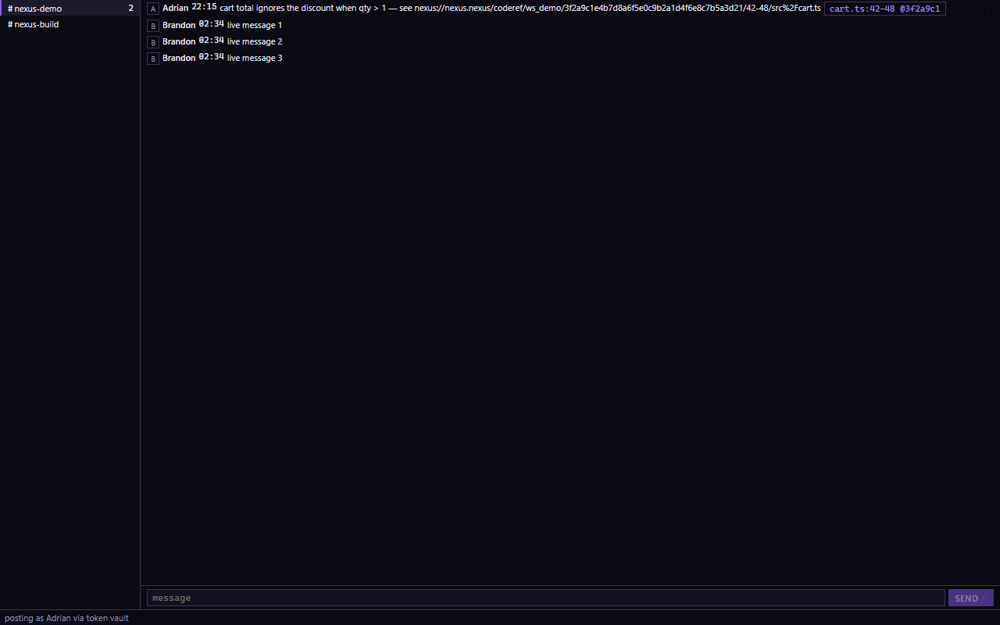 | 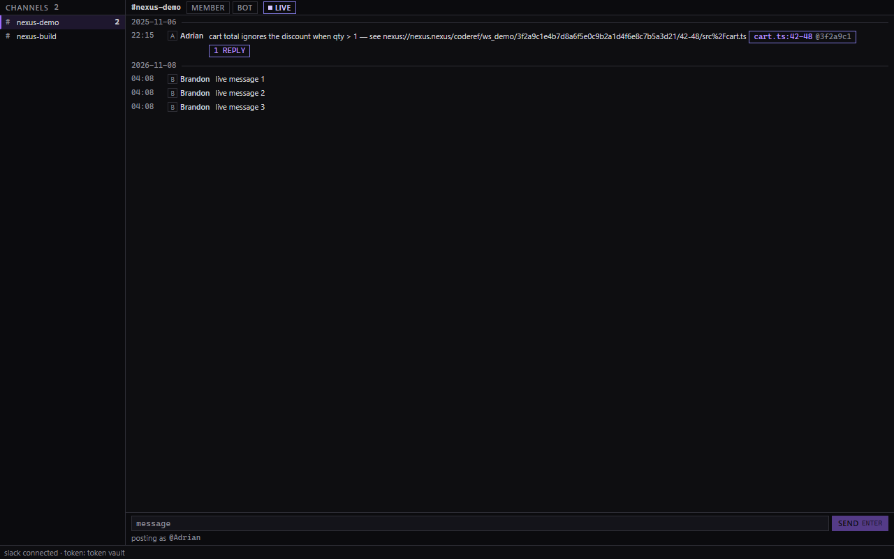 |

- CHANNELS header with count; 20 px rows (`#` mono, name, bold unread count, amber dot only when the bot is not a member); selected row with the 2 px accent rule and tint.
- History header with the mono channel name, MEMBER / BOT / LIVE badges; rows `time · name · text`; day separators; `N REPLIES` chips; code-ref chips in accent (dashed when stale); bot messages with the NEXUS label, APPROVE primary / REJECT danger; failed sends get RETRY and DISMISS (new `dismiss(clientId)` in the outbox, never drops a pending send).
- Composer: SEND (kbd ENTER) with the 20 px identity line ("posting as @name" or the amber no-token line); THREAD pane with `CLOSE ESC` and a MAKE TASK footer; links in Slack text now open through `ui.openExternal` (https only; before they did nothing). Narrow shot: `screens/after/chat-narrow.png`.

### Approvals view (`webviews/approvals`)

| before | after |
|---|---|
| 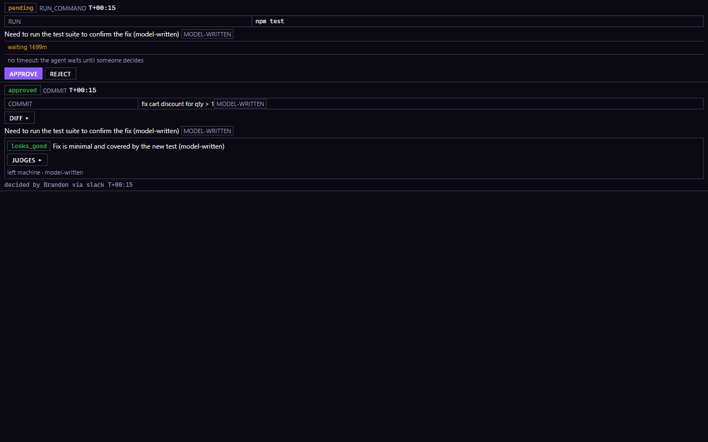 | 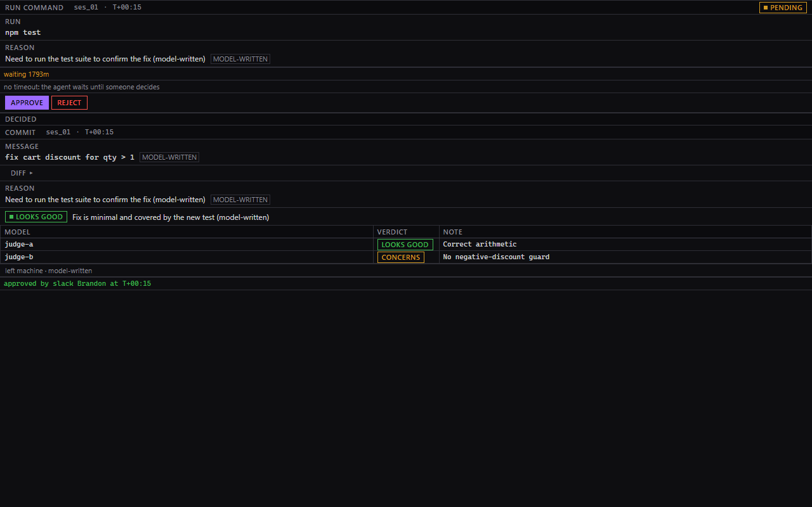 |

- One Region per approval: header `KIND · session id · T+ requested` with the status Badge; action in mono; reason with the MODEL-WRITTEN label; waiting note; APPROVE primary / REJECT danger only while undecided.
- Pending first (oldest first), then a 20 px DECIDED separator, then decided cards with the swarm verdict Badge (LOOKS GOOD / CONCERNS / DO NOT MERGE / REVIEW UNAVAILABLE), the judges table and the "approved by slack … at T+" line.
- The swarm verdict only changes the look; decisions are human clicks only; a decided approval never reopens. Narrow shot: `screens/after/approvals-narrow.png`.

### Task editor and plan review (`webviews/task`, `webviews/plan`)

| before | after |
|---|---|
| 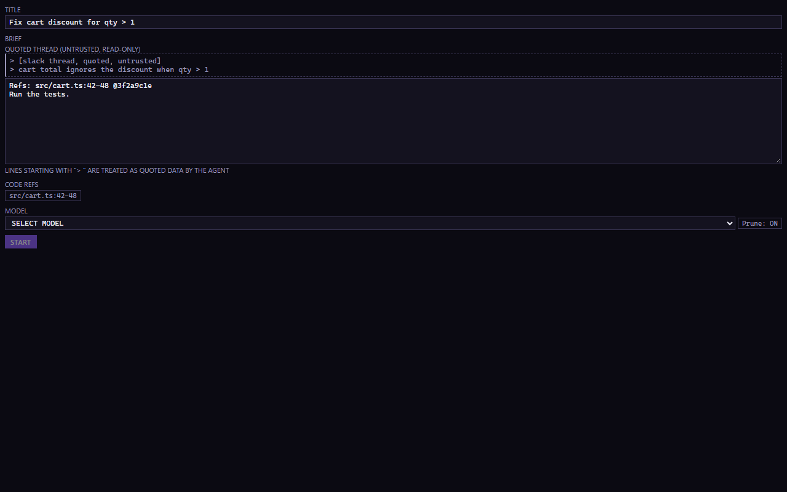 | 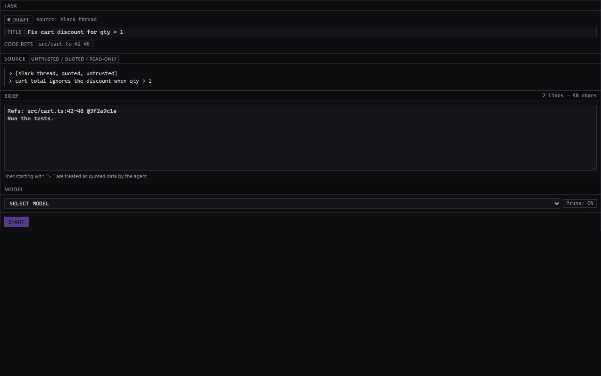 |
| 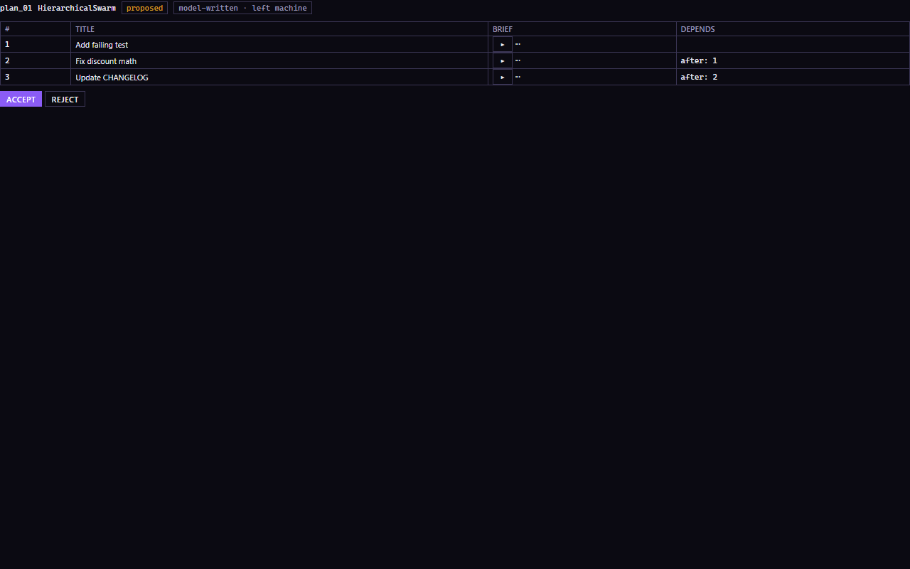 | 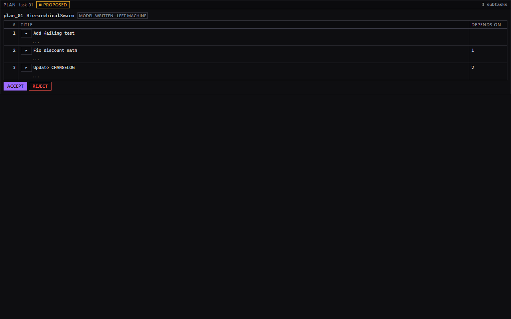 |

- Task editor: Regions TASK (status Badge, source kind, title, code refs) · SOURCE (the quoted thread as a `.nx-quote` block under an UNTRUSTED / QUOTED / READ-ONLY label) · BRIEF (mono textarea with a line and character count) · MODEL (kit Select; data-use chips LEAVES MACHINE / NOT USED FOR TRAINING / MAY BE USED FOR TRAINING / UNKNOWN, with Prune forcing LEAVES MACHINE + UNKNOWN) · START (primary) and BREAK INTO SUBTASKS.
- Plan review: PLAN header with the source title and a PROPOSED / ACCEPTED / REJECTED Badge, subtasks as a Table (`#` right-aligned mono · TITLE · DEPENDS ON "1, 2"), briefs labeled model-written, ACCEPT primary / REJECT danger only while proposed, created task ids after acceptance.
- Restyle only: the same bridge requests, brief builder and id resolution; 600 px shot in `screens/after/task-narrow.png`.

## 3. Decisions made for Adrian

Full list under "Decisions (design night)" in `progress/lane-1.md`. The ones that change how things look or behave:

- **Accent ramp**: Nexus Dark's `#9d6bff` family everywhere (`--nx-accent`, `-hi #b794ff`, `-lo #7f77dd`, `-deep #5b3fb3`, `-glow #d9caff`, `-tint #9d6bff22`); the kit's old `#8b5cf6` and the globe's `0x7f77dd` primary are gone.
- **Dark text on purple** (`--nx-accent-fg #0b0b0e`, 5.6:1) on every primary button, active segment and MERGE control; white on either purple fails 4.5:1. The style test carries a 22-pair contrast table and fails on any regression.
- **Layout**: Slack · Git · Approvals in the left `nexus` container; the globe in the center; the Agent view in a new `nexus-agent` secondary-side-bar container that the core default now opens, plus a one-time `nexus.agent.focus` at activation because the workbench hides an empty secondary side bar before the extension registers its container.
- **Session selection without a contract change**: `nexus.openSession` re-sets the Agent view's `<body data-session-id>` (page reload, replay from seq 0) through one optional `onResolveView` callback added to `src/bridge/host.ts`; the editor panel is a fallback only. With no id the view lists sessions itself and offers a switcher.
- **Git view** built tonight (D-10 folded into D-04) because the new `nexus.git` view needed an entry to be usable.
- **Rows**: tables stay 20 px, list rows are 22 px; both inside CLAUDE.md §6's range.
- **Deviations from §5**: the globe's top bar is a `div.nx-panel-header` with `role="toolbar"` (the kit's `PanelHeader` is a heading); the "4 px gutter" for the activity strip legend is a ~28 px label column; now-line dots are world-space spheres, not a fixed 3 px; instanced markers dim by color instead of 0.5 opacity; the timeline has no activity strip (it never had one) and always shows LIVE; the agent view's switcher refetches `sessions.list` on open/focus because the protocol has no sessions subscription; Slack `http://` links are linkified but dropped by the https-only opener; the task editor's START has no keyboard hint (no shortcut exists).
- **Worktrees** for workers lived in `C:\dev
exus-wt\D-xx`; the fork was launched from `C:\dev
exus` (the only built checkout) with `--extensionDevelopmentPath` pointing at this checkout's `extensions/nexus`.

## 4. Checks

- **Full verification loop** (`npm run typecheck && npm run lint && npx vitest run webviews src/features/views && npm run build:webviews && npm run contributes:check`, from `extensions/nexus`): last run on lane-1 at 04:25 EST, exit 0, `41 files / 473 tests` passed [proof: scratch verify-slice3.log]. _(final run at the freeze: see Status line)_
- **Baseline for comparison**: 37 files / 371 tests at 02:30 before any change.
- **Launch checks** (`.\scripts\code.bat --extensionDevelopmentPath=<repo>\extensions
exus` from the built checkout, fresh user-data dir, demo folder): three tonight; the last (04:13) showed the redesigned globe home tab-less, the Agent view open in the secondary side bar, Slack · Git · Approvals in the left container, "pick a model" in the status bar, no Chat panel, and only the known cold-start warning (`screens/after/launch-slice2.png`).
- **Console errors per entry** (isolated headless Chrome with `--enable-logging=stderr`, 360 and 1280 px, `?fake=1`): globe, timeline, git, session, approvals, chat, task, plan all **0** (the capture method was proven with a `console.error` probe page). A burst of 371 "Maximum update depth exceeded" lines was seen once in the shared browser pane while three workers navigated the same tab; it never reproduced in isolation and `webviews/session/loop.test.tsx` now guards it.
- **Globe frame time** (real GPU, headless Chrome over the DevTools protocol, 36 h fixture with 166 events, 5 s of `requestAnimationFrame`): 286 frames, p50 **16.7 ms**, p95 17.3 ms, avg 17.5 ms, one 66.7 ms hitch; renderer "ANGLE (Intel Iris Xe, Direct3D11)". That is the 60 Hz vsync interval, so the scene is not the bottleneck.
- **Keyboard reach** (Tab over the DevTools protocol, 1280 px): globe 6/6 controls reached, chat 5/5, git 80 of 101 (the loop's press cap, every reached row focused), approvals 3/3, session 6/6, task 3/3, plan 5/5, timeline 7/6 (one control gained after a live insert); nothing focused off-screen; the prefixed search input has no outline of its own because the ring is drawn on its wrapper (`.nx-input-wrap:focus-within`), and one task-editor control reported no outline {unverified which}.
- **Contrast**: the style test's 22-pair table over the fallback hex values, all ≥ 4.5:1 for text and ≥ 3:1 for UI, run on every test pass.

## 5. Not done / known issues

_(file, line, smallest next step)_

## 6. Demo notes

- The secondary side bar opens by default with the **Agent** view; if you close it, it stays closed for that workspace (`nexus.agentViewRevealed` in workspace state) until you open it from the layout toggle or `Nexus: Open session`. Below about 320 px wide the header strip truncates from the left and keeps the status badge and CANCEL visible.
- With no agent session yet the Agent view says "no agent session yet · start one from a Slack thread"; the first `nexus.openSession` (from a notification, the globe or a thread) points it at that session. The switcher lists sessions newest first, running ones on top.
- The globe's time window is the segmented 24H · 36H · 7D · 30D control; the 36H segment is filled purple when active. Search still takes Enter (top hit) and Escape; STOP TRACKING is ESC.
- Left container: **Slack** (channels 20 px rows, LIVE badge when the bot is in the channel), **Git** (BRANCHES, AGENT BRANCHES with the inline MERGE → CONFIRM MERGE, RECENT COMMITS last 24 h), **Approvals** (pending on top, DECIDED below).
- Every primary action is dark text on purple; red outlines are REJECT/danger only; amber is pending only.
- Dev-host only: an "Extension host did not start in 10 seconds" warning on this 8 GB laptop and a "created a webview without a content security policy" log line when the first Nexus view resolves; neither affects the views.
